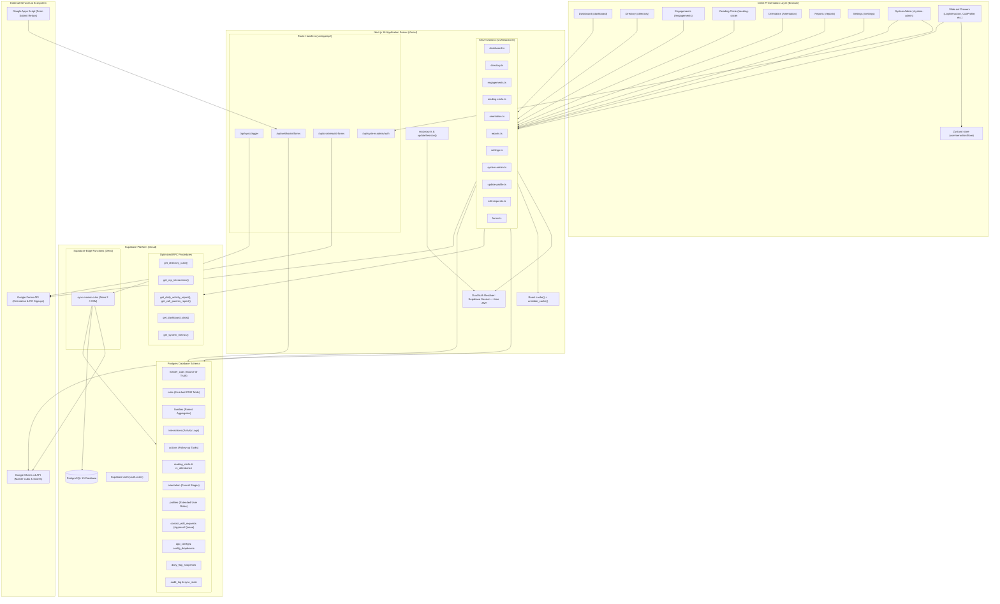

# CERO Tracker — Phase 1: Architecture Analysis

**Auditor:** Principal Software Architect & Performance Engineer  
**Scope:** Full-System Structural Assessment & Journey Traceability  
**Repository:** `cero-tracker`  
**Date:** 2026-10-29  

---

## 1. System Architecture Overview

CERO Tracker is a hybrid relationship management and operational tracking platform for Perbi Cubs. It coordinates interactions, reading circle session attendance, orientation funnels, parent contact details, and automated sync with Google Sheets and Google Forms.

The system is constructed with Next.js 16.4.2 (App Router with Turbopack), backed by Supabase PostgreSQL (with extensive PL/pgSQL RPC procedures, triggers, and Row Level Security), alongside Supabase Edge Functions (Deno runtime) for bidirectional external Google Sheets synchronization.

### System Architecture Diagram (Mermaid)

---

## 2. End-to-End Data Flow for the 5 Most Important User Journeys

### Journey 1: Representative Logs an Interaction & Action Follow-Up
- **UI Initiation:** User clicks "+ Log Interaction" in [AppShell.tsx](file:///c:/Users/Kay_Expert/Desktop/Kay_Xpert/Work/Perbicubs/Apps/cero-tracker/src/components/layout/AppShell.tsx#L53) or within [DirectoryClient.tsx](file:///c:/Users/Kay_Expert/Desktop/Kay_Xpert/Work/Perbicubs/Apps/cero-tracker/src/app/(auth)/directory/DirectoryClient.tsx#L16). The Zustand drawer store [store.ts:L33-L43](file:///c:/Users/Kay_Expert/Desktop/Kay_Xpert/Work/Perbicubs/Apps/cero-tracker/src/lib/store.ts#L33-L43) sets `isOpen = true`, populating pre-selected cub details.
- **Form State:** [LogInteractionDrawer.tsx](file:///c:/Users/Kay_Expert/Desktop/Kay_Xpert/Work/Perbicubs/Apps/cero-tracker/src/components/ui/LogInteractionDrawer.tsx#L34) captures interaction parameters (type, purpose, feedback, action required, action deadline, handled_by).
- **Server Action Mutation:** Form calls `submitInteraction(formData)` in [engagements.ts:L244](file:///c:/Users/Kay_Expert/Desktop/Kay_Xpert/Work/Perbicubs/Apps/cero-tracker/src/lib/actions/engagements.ts#L244).
- **Authentication & Validation:** Server verifies the session via `supabase.auth.getUser()` ([engagements.ts:L246](file:///c:/Users/Kay_Expert/Desktop/Kay_Xpert/Work/Perbicubs/Apps/cero-tracker/src/lib/actions/engagements.ts#L246)) and validates input against `InteractionSchema` ([engagements.ts:L222-L241](file:///c:/Users/Kay_Expert/Desktop/Kay_Xpert/Work/Perbicubs/Apps/cero-tracker/src/lib/actions/engagements.ts#L222-L241)).
- **Database Execution:**
  1. Inserts row into `public.interactions` ([engagements.ts:L252-L262](file:///c:/Users/Kay_Expert/Desktop/Kay_Xpert/Work/Perbicubs/Apps/cero-tracker/src/lib/actions/engagements.ts#L252-L262)).
  2. If `action_required === 'Yes'`, inserts associated row into `public.actions` ([engagements.ts:L267-L287](file:///c:/Users/Kay_Expert/Desktop/Kay_Xpert/Work/Perbicubs/Apps/cero-tracker/src/lib/actions/engagements.ts#L267-L287)).
  3. Updates `cubs.last_engagement_activity` ([engagements.ts:L290-L297](file:///c:/Users/Kay_Expert/Desktop/Kay_Xpert/Work/Perbicubs/Apps/cero-tracker/src/lib/actions/engagements.ts#L290-L297)).
  4. Updates `families.last_engagement_date` ([engagements.ts:L309-L318](file:///c:/Users/Kay_Expert/Desktop/Kay_Xpert/Work/Perbicubs/Apps/cero-tracker/src/lib/actions/engagements.ts#L309-L318)).
- **Response & Invalidation:** Action completes; client triggers `toast.success()` via Sonner, closes drawer, and triggers server cache revalidation.
- **Architectural Flaw:** Steps 1–4 are executed sequentially outside of a PostgreSQL transaction. A transient failure midway leaves the database in an inconsistent state.

### Journey 2: Directory Browsing & Deep Filtering (Cubs & Families)
- **UI Route:** Rep loads `/directory` ([page.tsx](file:///c:/Users/Kay_Expert/Desktop/Kay_Xpert/Work/Perbicubs/Apps/cero-tracker/src/app/(auth)/directory/page.tsx#L1-L45)).
- **Server Data Loading:** `DirectoryPage` parallel-fetches initial datasets using `Promise.all([getDirectoryCubs(), getDirectoryFamilies(), ...])` ([page.tsx:L32-L38](file:///c:/Users/Kay_Expert/Desktop/Kay_Xpert/Work/Perbicubs/Apps/cero-tracker/src/app/(auth)/directory/page.tsx#L32-L38)).
- **Business Logic Layer:** [directory.ts:L24-L32](file:///c:/Users/Kay_Expert/Desktop/Kay_Xpert/Work/Perbicubs/Apps/cero-tracker/src/lib/actions/directory.ts#L24-L32) invokes the stored procedure `get_directory_cubs(p_rep)`.
- **Database Execution:** The RPC performs an indexed join between `cubs` and `master_cubs`, enforcing representative ownership filtering unless the caller possesses the `admin` or `viewer` role.
- **Client Presentation:** The complete dataset (often thousands of rows) is passed to [DirectoryClient.tsx:L7-L56](file:///c:/Users/Kay_Expert/Desktop/Kay_Xpert/Work/Perbicubs/Apps/cero-tracker/src/app/(auth)/directory/DirectoryClient.tsx#L7-L56). All searching, multi-criteria filtering ([DirectoryCubFilter.tsx](file:///c:/Users/Kay_Expert/Desktop/Kay_Xpert/Work/Perbicubs/Apps/cero-tracker/src/components/ui/DirectoryCubFilter.tsx)), sorting ([useTableSort.ts](file:///c:/Users/Kay_Expert/Desktop/Kay_Xpert/Work/Perbicubs/Apps/cero-tracker/src/hooks/useTableSort.ts)), and pagination (`PAGE_SIZE = 25`) execute entirely in browser memory.

### Journey 3: Automated & Manual Ingestion from Google Sheets to Master DB
- **Trigger:** Either a scheduled HTTP request or an admin clicking "Trigger Full Sync" on `/system-admin` calls `POST /api/sync/trigger` ([trigger/route.ts:L7](file:///c:/Users/Kay_Expert/Desktop/Kay_Xpert/Work/Perbicubs/Apps/cero-tracker/src/app/api/sync/trigger/route.ts#L7)).
- **Authentication:** Verifies admin profile ([route.ts:L16-L24](file:///c:/Users/Kay_Expert/Desktop/Kay_Xpert/Work/Perbicubs/Apps/cero-tracker/src/app/api/sync/trigger/route.ts#L16-L24)).
- **Edge Execution:** Forwards request to Supabase Edge Function `sync-master-cubs` using `SUPABASE_SERVICE_ROLE_KEY` ([route.ts:L34-L41](file:///c:/Users/Kay_Expert/Desktop/Kay_Xpert/Work/Perbicubs/Apps/cero-tracker/src/app/api/sync/trigger/route.ts#L34-L41)).
- **External Integration:** Edge function [index.ts:L28-L71](file:///c:/Users/Kay_Expert/Desktop/Kay_Xpert/Work/Perbicubs/Apps/cero-tracker/supabase/functions/sync-master-cubs/index.ts#L28-L71) authenticates via Google Service Account RSA-SHA256 JWT, calls `spreadsheets.values.get` across 4 sheet ranges.
- **Database Reconciliation:**
  - Parses rows, maps column headers dynamically from `app_config` values.
  - Batches upserts into `public.master_cubs` ([index.ts:L290-L340](file:///c:/Users/Kay_Expert/Desktop/Kay_Xpert/Work/Perbicubs/Apps/cero-tracker/supabase/functions/sync-master-cubs/index.ts)).
  - Runs Postgres trigger/procedure `upsert_synced_cubs()` to synchronize `public.cubs` and aggregate `public.families`.
  - Updates `public.sync_state` and writes audit records to `public.audit_log`.

### Journey 4: Reading Circle Session Enrollment & Attendance
- **UI Route:** User opens `/reading-circle` ([ReadingCircleClient.tsx](file:///c:/Users/Kay_Expert/Desktop/Kay_Xpert/Work/Perbicubs/Apps/cero-tracker/src/app/(auth)/reading-circle/ReadingCircleClient.tsx#L1-L1009)).
- **Data Load:** Retrieves active enrollment, past attendance history, and session rosters via [reading-circle.ts](file:///c:/Users/Kay_Expert/Desktop/Kay_Xpert/Work/Perbicubs/Apps/cero-tracker/src/lib/actions/reading-circle.ts#L18-L150).
- **Session Mutation:** Rep updates a cub's assigned RC session via [RCChangeSessionDrawer.tsx](file:///c:/Users/Kay_Expert/Desktop/Kay_Xpert/Work/Perbicubs/Apps/cero-tracker/src/components/drawers/RCChangeSessionDrawer.tsx) or records attendance in bulk via `recordAttendanceBulk()` ([reading-circle.ts:L310-L360](file:///c:/Users/Kay_Expert/Desktop/Kay_Xpert/Work/Perbicubs/Apps/cero-tracker/src/lib/actions/reading-circle.ts)).
- **Database Layer:** Updates `reading_circle` assignment and inserts records into `rc_attendance`.
- **Cache Invalidation:** Calls `revalidatePath('/reading-circle')` and `revalidateTag('rc-sessions')`.

### Journey 5: Contact Edit Request Submission & Approval Workflow
- **Submission:** Rep views cub details in [CubProfileDrawer.tsx](file:///c:/Users/Kay_Expert/Desktop/Kay_Xpert/Work/Perbicubs/Apps/cero-tracker/src/components/drawers/CubProfileDrawer.tsx) and modifies parent phone, email, or language.
- **Server Action:** Calls `submitContactEditRequest()` in [edit-requests.ts:L55-L135](file:///c:/Users/Kay_Expert/Desktop/Kay_Xpert/Work/Perbicubs/Apps/cero-tracker/src/lib/actions/edit-requests.ts#L55-L135).
- **Validation:** Checks for active pending requests on the same entity to prevent duplicate conflicts ([edit-requests.ts:L85-L95](file:///c:/Users/Kay_Expert/Desktop/Kay_Xpert/Work/Perbicubs/Apps/cero-tracker/src/lib/actions/edit-requests.ts#L85-L95)). Inserts record into `public.contact_edit_requests` with status `'pending'`.
- **Admin Review:** Admin navigates to `/system-admin` -> Approvals Tab ([ApprovalsTab.tsx:L1-L578](file:///c:/Users/Kay_Expert/Desktop/Kay_Xpert/Work/Perbicubs/Apps/cero-tracker/src/app/system-admin/ApprovalsTab.tsx#L1-L578)).
- **Approval Execution:** Admin clicks "Approve". Calls `approveContactEditRequest(requestId)` ([edit-requests.ts:L160-L280](file:///c:/Users/Kay_Expert/Desktop/Kay_Xpert/Work/Perbicubs/Apps/cero-tracker/src/lib/actions/edit-requests.ts#L160-L280)):
  1. Authorizes caller via dual admin session check ([edit-requests.ts:L15-L45](file:///c:/Users/Kay_Expert/Desktop/Kay_Xpert/Work/Perbicubs/Apps/cero-tracker/src/lib/actions/edit-requests.ts#L15-L45)).
  2. Updates local Postgres records in `master_cubs` and `families`.
  3. Executes remote write-back to Google Sheets master row via `updateCubAndParentProfile()` ([update-profile.ts:L240-L380](file:///c:/Users/Kay_Expert/Desktop/Kay_Xpert/Work/Perbicubs/Apps/cero-tracker/src/lib/actions/update-profile.ts#L240-L380)).
  4. Marks request status as `'approved'` with admin audit metadata.

---

## 3. Layering, Separation of Concerns & Module Boundaries

### Layer Evaluation

| Layer | Implementation Pattern | Separation & Boundary Integrity Assessment |
| :--- | :--- | :--- |
| **Presentation (UI)** | Next.js App Router (Client Components) | **POOR**. Heavy business logic, pagination algorithms, complex multi-field filter reducers, and CSV export string builders leak directly into client components ([SystemAdminClient.tsx](file:///c:/Users/Kay_Expert/Desktop/Kay_Xpert/Work/Perbicubs/Apps/cero-tracker/src/app/system-admin/SystemAdminClient.tsx), [ReportsClient.tsx](file:///c:/Users/Kay_Expert/Desktop/Kay_Xpert/Work/Perbicubs/Apps/cero-tracker/src/app/(auth)/reports/ReportsClient.tsx)). |
| **Controller / Mutation** | Next.js Server Actions (`'use server'`) | **MIXED**. Server actions act as both controllers and service orchestrators. Several actions bypass service boundaries and execute direct database queries and remote Google APIs in single monolithic functions ([update-profile.ts](file:///c:/Users/Kay_Expert/Desktop/Kay_Xpert/Work/Perbicubs/Apps/cero-tracker/src/lib/actions/update-profile.ts), [system-admin.ts](file:///c:/Users/Kay_Expert/Desktop/Kay_Xpert/Work/Perbicubs/Apps/cero-tracker/src/lib/actions/system-admin.ts)). |
| **Data Access Layer** | Supabase JS Client & SQL RPCs | **FRAGMENTED**. Database access is split inconsistently between: (1) Supabase user-scoped client (`server.ts`), (2) Supabase service-role client (`admin.ts`), (3) ad-hoc inline service role instantiations, and (4) Postgres stored procedures. |
| **Domain Models & Types** | Central `src/lib/types.ts` | **MODERATE**. Core types are consolidated in `types.ts`, but extensive use of `any` (220 instances) degrades domain boundary safety. |

---

## 4. God Files and High Cyclomatic Complexity Hotspots

The repository suffers from severe concentration of responsibilities in 8 monolithic "God Files":

| File Path | Lines of Code (LOC) | Primary Concerns Packed into File | Severity |
| :--- | :--- | :--- | :--- |
| [`src/app/system-admin/SystemAdminClient.tsx`](file:///c:/Users/Kay_Expert/Desktop/Kay_Xpert/Work/Perbicubs/Apps/cero-tracker/src/app/system-admin/SystemAdminClient.tsx) | **3,337** | 8 distinct admin tabs, sync configuration, database purges, migration triggers, log filtering, error management | **CRITICAL** |
| [`src/app/(auth)/reports/ReportsClient.tsx`](file:///c:/Users/Kay_Expert/Desktop/Kay_Xpert/Work/Perbicubs/Apps/cero-tracker/src/app/(auth)/reports/ReportsClient.tsx) | **2,162** | 6 complex report views, date range controls, CSV export engines, tab switching, drill-down modals | **CRITICAL** |
| [`src/app/(auth)/orientation/OrientationClient.tsx`](file:///c:/Users/Kay_Expert/Desktop/Kay_Xpert/Work/Perbicubs/Apps/cero-tracker/src/app/(auth)/orientation/OrientationClient.tsx) | **1,964** | Orientation funnel, booking drawer, attendance marking, stage transitions, table sorting, filter state | **HIGH** |
| [`src/app/(auth)/engagements/EngagementsClient.tsx`](file:///c:/Users/Kay_Expert/Desktop/Kay_Xpert/Work/Perbicubs/Apps/cero-tracker/src/app/(auth)/engagements/EngagementsClient.tsx) | **1,217** | Interaction timeline, action task board, status mutation modals, date range selectors | **HIGH** |
| [`src/components/ui/Skeleton.tsx`](file:///c:/Users/Kay_Expert/Desktop/Kay_Xpert/Work/Perbicubs/Apps/cero-tracker/src/components/ui/Skeleton.tsx) | **1,204** | Over 20 specialized skeleton loading layouts concatenated in a single file | **MEDIUM** |
| [`src/app/(auth)/directory/DirectoryClient.tsx`](file:///c:/Users/Kay_Expert/Desktop/Kay_Xpert/Work/Perbicubs/Apps/cero-tracker/src/app/(auth)/directory/DirectoryClient.tsx) | **1,125** | Cubs tab, Families tab, client-side pagination, profile drawer mounting, export | **HIGH** |
| [`src/app/(auth)/settings/SettingsClient.tsx`](file:///c:/Users/Kay_Expert/Desktop/Kay_Xpert/Work/Perbicubs/Apps/cero-tracker/src/app/(auth)/settings/SettingsClient.tsx) | **1,122** | User management, password inspection, role assignment, dropdown category management, forms config | **HIGH** |
| [`src/app/(auth)/reading-circle/ReadingCircleClient.tsx`](file:///c:/Users/Kay_Expert/Desktop/Kay_Xpert/Work/Perbicubs/Apps/cero-tracker/src/app/(auth)/reading-circle/ReadingCircleClient.tsx) | **1,009** | Reading circle roster, weekly attendance marking, session switching, category filters | **HIGH** |

---

## 5. Architectural Drift & Broken Consistency

During reconnaissance and deep code inspection, multiple instances of architectural drift were identified where recent features circumvent established standards:

### 1. Dual Incompatible Authentication Systems
- **Established Standard:** Supabase Auth cookie session handled via `@supabase/ssr` and `src/proxy.ts`.
- **Drifted Pattern:** `/system-admin` bypasses Supabase Auth entirely, generating custom JWT tokens via `jose` stored in cookie `system_admin_session` ([systemAdminAuth.ts:L20-L41](file:///c:/Users/Kay_Expert/Desktop/Kay_Xpert/Work/Perbicubs/Apps/cero-tracker/src/lib/systemAdminAuth.ts#L20-L41)). As a result, server actions like [edit-requests.ts:L15-L45](file:///c:/Users/Kay_Expert/Desktop/Kay_Xpert/Work/Perbicubs/Apps/cero-tracker/src/lib/actions/edit-requests.ts#L15-L45) and [forms.ts:L37-L51](file:///c:/Users/Kay_Expert/Desktop/Kay_Xpert/Work/Perbicubs/Apps/cero-tracker/src/lib/actions/forms.ts#L37-L51) now require awkward fallback boilerplate to resolve "who is the admin".

### 2. Service Role Client Proliferation (RLS Bypass)
- **Established Standard:** The application layer uses `createClient()` from `src/lib/supabase/server.ts` so that PostgreSQL Row Level Security (RLS) protects rows based on `auth.uid()`.
- **Drifted Pattern:** Multiple server actions ([system-admin.ts:L11-L19](file:///c:/Users/Kay_Expert/Desktop/Kay_Xpert/Work/Perbicubs/Apps/cero-tracker/src/lib/actions/system-admin.ts#L11-L19), [update-profile.ts:L33-L39](file:///c:/Users/Kay_Expert/Desktop/Kay_Xpert/Work/Perbicubs/Apps/cero-tracker/src/lib/actions/update-profile.ts#L33-L39), [edit-requests.ts:L47-L53](file:///c:/Users/Kay_Expert/Desktop/Kay_Xpert/Work/Perbicubs/Apps/cero-tracker/src/lib/actions/edit-requests.ts#L47-L53), [settings.ts:L161](file:///c:/Users/Kay_Expert/Desktop/Kay_Xpert/Work/Perbicubs/Apps/cero-tracker/src/lib/actions/settings.ts#L161), [reading-circle.ts:L24](file:///c:/Users/Kay_Expert/Desktop/Kay_Xpert/Work/Perbicubs/Apps/cero-tracker/src/lib/actions/reading-circle.ts#L24)) bypass RLS by invoking the service-role client, forfeiting database-level security guarantees.

### 3. Duplicate Google API Client Implementations
- **Established Standard:** Using the official `googleapis` package ([forms.ts:L7](file:///c:/Users/Kay_Expert/Desktop/Kay_Xpert/Work/Perbicubs/Apps/cero-tracker/src/lib/actions/forms.ts#L7)).
- **Drifted Pattern:** [update-profile.ts:L41-L65](file:///c:/Users/Kay_Expert/Desktop/Kay_Xpert/Work/Perbicubs/Apps/cero-tracker/src/lib/actions/update-profile.ts#L41-L65) and [supabase/functions/sync-master-cubs/index.ts:L28-L71](file:///c:/Users/Kay_Expert/Desktop/Kay_Xpert/Work/Perbicubs/Apps/cero-tracker/supabase/functions/sync-master-cubs/index.ts#L28-L71) reimplement manual RSASSA-PKCS1-v1_5 JWT creation using raw crypto and Node `createSign`.

### 4. Plaintext Password Storage Anti-Pattern
- **Established Standard:** Passwords hashed and securely stored inside Supabase Auth (`auth.users`).
- **Drifted Pattern:** Migration [`20261029000001_add_viewer_role_and_plain_password.sql`](file:///c:/Users/Kay_Expert/Desktop/Kay_Xpert/Work/Perbicubs/Apps/cero-tracker/supabase/migrations/20261029000001_add_viewer_role_and_plain_password.sql#L18-L19) added a `plain_password` column to `public.profiles`. Plaintext passwords are now saved in [settings.ts:L181](file:///c:/Users/Kay_Expert/Desktop/Kay_Xpert/Work/Perbicubs/Apps/cero-tracker/src/lib/actions/settings.ts#L181) and exposed across the wire to the frontend client.

---

## 6. Architecture Findings & Recommendations

[ARCH-01] Monolithic Client God Components Exceeding 3,000 Lines | Severity: High | Effort: L  
Location: [`src/app/system-admin/SystemAdminClient.tsx:L1-L3337`](file:///c:/Users/Kay_Expert/Desktop/Kay_Xpert/Work/Perbicubs/Apps/cero-tracker/src/app/system-admin/SystemAdminClient.tsx#L1-L3337), [`src/app/(auth)/reports/ReportsClient.tsx:L1-L2162`](file:///c:/Users/Kay_Expert/Desktop/Kay_Xpert/Work/Perbicubs/Apps/cero-tracker/src/app/(auth)/reports/ReportsClient.tsx#L1-L2162)  
Evidence: Client files contain thousands of lines handling dozens of tabs, raw state management, modals, and export utilities.  
Impact: Bloats initial JS bundle, slows page transitions, impairs maintainability, and increases the blast radius of regressions.  
Fix: Decompose into atomic tab modules and feature containers using dynamic imports (`next/dynamic`).

[ARCH-02] Split Incompatible Authentication Planes | Severity: High | Effort: M  
Location: [`src/lib/systemAdminAuth.ts:L1-L112`](file:///c:/Users/Kay_Expert/Desktop/Kay_Xpert/Work/Perbicubs/Apps/cero-tracker/src/lib/systemAdminAuth.ts#L1-L112), [`src/lib/supabase/proxy.ts:L41-L47`](file:///c:/Users/Kay_Expert/Desktop/Kay_Xpert/Work/Perbicubs/Apps/cero-tracker/src/lib/supabase/proxy.ts#L41-L47)  
Evidence: System Admin portal relies on custom Jose JWT cookies while the rest of the application relies on Supabase Auth sessions, forcing complex multi-auth resolution functions.  
Impact: Session desynchronization, audit log inconsistencies, and elevated risk of authorization bypass.  
Fix: Unify auth under Supabase Auth with custom claims or role-based session enforcement.

[ARCH-03] Unchecked Multi-Step Mutations Lacking Database Transactions | Severity: High | Effort: M  
Location: [`src/lib/actions/engagements.ts:L252-L318`](file:///c:/Users/Kay_Expert/Desktop/Kay_Xpert/Work/Perbicubs/Apps/cero-tracker/src/lib/actions/engagements.ts#L252-L318), [`src/lib/actions/system-admin.ts:L416-L448`](file:///c:/Users/Kay_Expert/Desktop/Kay_Xpert/Work/Perbicubs/Apps/cero-tracker/src/lib/actions/system-admin.ts#L416-L448)  
Evidence: Critical workflows perform multiple separate `insert` and `update` calls without an encompassing database transaction.  
Impact: Partial write failures leave orphan actions, un-updated family timelines, or broken cascade states.  
Fix: Wrap multi-table operations into dedicated PL/pgSQL transactional RPC procedures.
