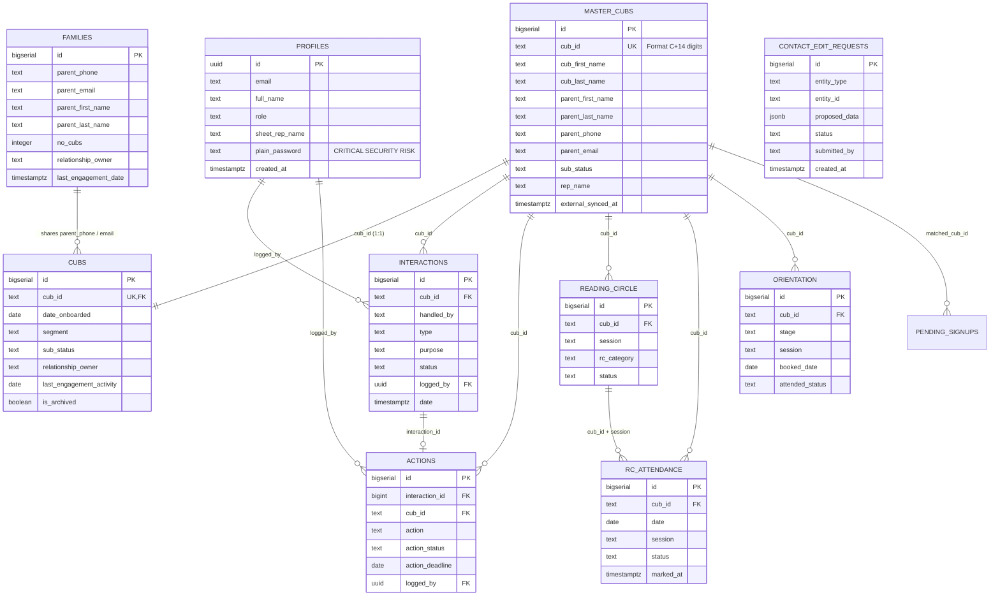

# CERO Tracker — Phase 4: Database Audit

**Auditor:** Principal Software Architect & Performance Engineer  
**Scope:** PostgreSQL Schema, Entity Relationships, Constraints, Indexing, Query Optimization & Migration Drift  
**Repository:** `cero-tracker`  
**Date:** 2026-10-29  

---

## 1. Executive Database Assessment

The database architecture is built on PostgreSQL 15 managed via Supabase. It comprises 18 tables, 40 stored functions/RPCs, 64 indexes, and 96 Row Level Security (RLS) policies defined across 38 migration files. 

While recent migrations have introduced high-value composite indexes and optimized stored procedures to circumvent PostgREST URI limits, significant risks remain around:
1. **Plaintext Password Storage Column:** Stored in `public.profiles.plain_password` ([migration: 20261029000001](file:///c:/Users/Kay_Expert/Desktop/Kay_Xpert/Work/Perbicubs/Apps/cero-tracker/supabase/migrations/20261029000001_add_viewer_role_and_plain_password.sql#L18-L19)).
2. **Denormalization Anomalies:** Parent contact details (`parent_first_name`, `parent_last_name`, `parent_phone`, `parent_email`) are duplicated across 5 distinct tables (`master_cubs`, `families`, `interactions`, `actions`, `orientation`).
3. **Missing Foreign Key Cascades & Restrict Mismatches:** `interactions` has a `RESTRICT` constraint to `master_cubs`, causing manual cascade deletion scripts in `system-admin.ts` ([L416-L438](file:///c:/Users/Kay_Expert/Desktop/Kay_Xpert/Work/Perbicubs/Apps/cero-tracker/src/lib/actions/system-admin.ts#L416-L438)).
4. **Unbounded Queries and Missing Server-Side Pagination:** Multiple server actions fetch entire tables into memory without limits.

---

## 2. Entity-Relationship Diagram (Mermaid)



---

## 3. Schema Structure & Table Inventory

| Table Name | Purpose / Domain | Key Indexes | Foreign Key Constraints |
| :--- | :--- | :--- | :--- |
| `profiles` | User accounts and role hierarchy (`rep`, `admin`, `viewer`) | `id` (PK), `email` (UK) | `id REFERENCES auth.users(id) ON DELETE CASCADE` |
| `master_cubs` | Synced source of truth for all enrolled cubs | `cub_id` (UK), `rep_name`, `parent_phone`, `parent_email` | None (Source table) |
| `cubs` | Enriched CRM working table for active/expired cubs | `cub_id` (UK), `relationship_owner`, `sub_status` | `cub_id REFERENCES master_cubs(cub_id) ON DELETE CASCADE` |
| `families` | Aggregated parent profiles and multi-cub households | `(parent_phone, parent_email)` (UK), `relationship_owner` | None (Soft association) |
| `interactions` | Activity logs (calls, messages, visits) | `cub_id`, `logged_by`, `date` | `cub_id REFERENCES master_cubs(cub_id) ON DELETE RESTRICT` |
| `actions` | Follow-up tasks arising from interactions | `interaction_id`, `cub_id`, `action_status`, `action_deadline` | `interaction_id REFERENCES interactions(id) ON DELETE CASCADE` |
| `reading_circle` | Reading circle group enrollments and session times | `cub_id`, `session`, `status` | `cub_id REFERENCES master_cubs(cub_id) ON DELETE CASCADE` |
| `rc_attendance` | Weekly reading circle attendance records | `cub_id`, `date`, `session`, `status` | `cub_id REFERENCES master_cubs(cub_id) ON DELETE CASCADE` |
| `orientation` | Onboarding journey and orientation funnel stages | `cub_id`, `stage`, `session`, `attended_status` | `cub_id REFERENCES master_cubs(cub_id) ON DELETE CASCADE` |
| `pending_signups` | Ingested external form responses awaiting matching | `matched_cub_id`, `status`, `idempotency_key` | `matched_cub_id REFERENCES master_cubs(cub_id) ON DELETE SET NULL` |
| `contact_edit_requests`| Approval queue for rep contact information changes | `status`, `entity_id` | None |
| `handover_notes` | Daily shift handover summaries and pending flags | `rep`, `date` | None |
| `daily_flag_snapshots` | Pre-computed daily aggregate metrics for reporting | `snapshot_date`, `rep`, `flag` | None |
| `config_dropdowns` | System-wide dropdown values (interaction types, etc.) | `category`, `is_active` | None |
| `app_config` | Dynamic sheet IDs, form IDs, and grade mappings | `key` (PK) | None |
| `sync_state` | Status, timestamps, and row counts of sheet sync runs | `sync_type` (PK) | None |
| `audit_log` | System administrative mutation event history | `timestamp`, `user_id`, `action` | None |
| `email_history` | Email dispatch and delivery history | `cub_id`, `sent_at` | `cub_id REFERENCES master_cubs(cub_id) ON DELETE CASCADE` |

---

## 4. Normalization & Data Integrity Deficiencies

### 1. Excessive Denormalization of Parent Identity
- **Evidence:** `parent_first_name`, `parent_last_name`, and `parent_phone` are stored redundantly in `master_cubs`, `families`, `interactions`, `actions`, `orientation`, and `pending_signups`.
- **Integrity Problem:** When a parent's phone number is updated in `master_cubs` via `updateCubAndParentProfile()`, historical rows in `interactions` and `actions` retain stale phone numbers. A parent search by new phone number fails to find their historical action items unless complex multi-table joins are executed.

### 2. `RESTRICT` Foreign Key Conflict on `interactions`
- **Location:** [`supabase/migrations/20261008000000_initial_schema.sql:L150`](file:///c:/Users/Kay_Expert/Desktop/Kay_Xpert/Work/Perbicubs/Apps/cero-tracker/supabase/migrations/20261008000000_initial_schema.sql#L150)
- **Evidence:** `cub_id REFERENCES public.master_cubs(cub_id) ON DELETE RESTRICT`.
- **Integrity Problem:** While all other cub child tables (`cubs`, `reading_circle`, `orientation`, `email_history`) use `ON DELETE CASCADE`, `interactions` specifies `RESTRICT`. When an admin attempts to delete a cub in `clearTable()` ([system-admin.ts:L416-L435](file:///c:/Users/Kay_Expert/Desktop/Kay_Xpert/Work/Perbicubs/Apps/cero-tracker/src/lib/actions/system-admin.ts#L416-L435)), the database throws foreign key constraint errors unless interactions are manually pre-deleted in application code.

### 3. Untracked Migration with Plaintext Password Storage
- **Location:** [`supabase/migrations/20261029000001_add_viewer_role_and_plain_password.sql:L18-L19`](file:///c:/Users/Kay_Expert/Desktop/Kay_Xpert/Work/Perbicubs/Apps/cero-tracker/supabase/migrations/20261029000001_add_viewer_role_and_plain_password.sql#L18-L19)
- **Evidence:** `ALTER TABLE public.profiles ADD COLUMN IF NOT EXISTS plain_password TEXT DEFAULT NULL;`
- **Integrity Problem:** Storing plaintext credentials in a database table is an extreme security liability. It bypasses Supabase Auth's salted bcrypt hashing and leaks credentials in `SELECT *` queries.

---

## 5. Query Analysis: N+1, SELECT * & Unbounded Scans

### 1. Unbounded Table Extraction in `getInteractions()`
- **Location:** [`src/lib/actions/engagements.ts:L33-L58`](file:///c:/Users/Kay_Expert/Desktop/Kay_Xpert/Work/Perbicubs/Apps/cero-tracker/src/lib/actions/engagements.ts#L33-L58)
- **Evidence:**
  ```ts
  let query = supabase.from('interactions').select('*').order('date', { ascending: false });
  // ...
  const { data, error } = await query;
  ```
- **Flaw:** Executes `SELECT *` on the entire `interactions` table without a `LIMIT` or `WHERE` clause when the RPC fallback occurs or when `ownedCubIds.length > 150`.

### 2. Wildcard `SELECT *` on Profiles
- **Location:** [`src/app/(auth)/settings/page.tsx:L21`](file:///c:/Users/Kay_Expert/Desktop/Kay_Xpert/Work/Perbicubs/Apps/cero-tracker/src/app/(auth)/settings/page.tsx#L21), [`src/lib/actions/settings.ts:L27`](file:///c:/Users/Kay_Expert/Desktop/Kay_Xpert/Work/Perbicubs/Apps/cero-tracker/src/lib/actions/settings.ts#L27)
- **Evidence:** `supabase.from('profiles').select('*')`.
- **Flaw:** Pulls all columns from `profiles`, including the newly added `plain_password` column, and exposes it to the client.

### 3. Sequential 1,000-Row Paging Loop in Fallback Queries
- **Location:** [`src/lib/actions/directory.ts:L34-L72`](file:///c:/Users/Kay_Expert/Desktop/Kay_Xpert/Work/Perbicubs/Apps/cero-tracker/src/lib/actions/directory.ts#L34-L72), [`src/lib/actions/dashboard.ts:L220-L255`](file:///c:/Users/Kay_Expert/Desktop/Kay_Xpert/Work/Perbicubs/Apps/cero-tracker/src/lib/actions/dashboard.ts#L220-L255)
- **Evidence:** A `while (hasMore)` loop repeatedly calls PostgREST with `.range(from, from + 1000 - 1)` until all rows are retrieved.
- **Flaw:** If the RPC procedure is unavailable or fails, this loop triggers 5–10 sequential network round-trips to Supabase, each waiting on the previous request before making the next call.

---

## 6. Migration History & Drift Analysis

The repository contains 38 migrations in `supabase/migrations/`.
- **High Optimization Efforts:** Migrations `20261015040000_perf_optimization.sql`, `20261021060001_reports_rpcs.sql`, and `20261022070000_perf_accuracy_optimizations.sql` added composite indexes and materialized aggregations for reports.
- **Drift Hotspot:** Migration `20261029000001_add_viewer_role_and_plain_password.sql` is **untracked in git** (created locally on the dev environment). It alters constraints and adds columns that do not exist in the baseline schema or production deployment documentation.
- **Lack of Down Migrations:** None of the 38 migration files include rollback (`DOWN`) scripts. Reverting a migration requires manual SQL inspection.

---

## 7. Database Findings & Recommendations

[DB-01] Critical Security Liability: Plaintext Password Storage Column | Severity: Critical | Effort: S  
Location: [`supabase/migrations/20261029000001_add_viewer_role_and_plain_password.sql:L18-L19`](file:///c:/Users/Kay_Expert/Desktop/Kay_Xpert/Work/Perbicubs/Apps/cero-tracker/supabase/migrations/20261029000001_add_viewer_role_and_plain_password.sql#L18-L19)  
Evidence: `plain_password` column on `public.profiles` populated by server actions and queried via `SELECT *`.  
Impact: Catastrophic credential breach risk; exposes user passwords directly to anyone with table access or network payload visibility.  
Fix: Drop the column immediately (`ALTER TABLE public.profiles DROP COLUMN plain_password;`). Rely exclusively on Supabase Auth password reset links.

[DB-02] Unbounded Full Table Queries on Expanding Activity Logs | Severity: High | Effort: M  
Location: [`src/lib/actions/engagements.ts:L33-L58`](file:///c:/Users/Kay_Expert/Desktop/Kay_Xpert/Work/Perbicubs/Apps/cero-tracker/src/lib/actions/engagements.ts#L33-L58)  
Evidence: `SELECT *` on `interactions` without pagination or date range limits.  
Impact: Memory exhaustion and query timeouts as total logged interactions grow past 10,000 records.  
Fix: Enforce mandatory date range filtering (`WHERE date >= NOW() - INTERVAL '60 days'`) and pagination.

[DB-03] `SELECT *` Column Projections on Profiles Leaking Internal Data | Severity: High | Effort: S  
Location: [`src/lib/actions/settings.ts:L27`](file:///c:/Users/Kay_Expert/Desktop/Kay_Xpert/Work/Perbicubs/Apps/cero-tracker/src/lib/actions/settings.ts#L27), [`src/app/(auth)/settings/page.tsx:L21`](file:///c:/Users/Kay_Expert/Desktop/Kay_Xpert/Work/Perbicubs/Apps/cero-tracker/src/app/(auth)/settings/page.tsx#L21)  
Evidence: Unfiltered `select('*')` on the `profiles` table.  
Impact: Exposes internal profile attributes and credentials to client components.  
Fix: Replace with explicit projections: `.select('id, email, full_name, role, sheet_rep_name')`.
