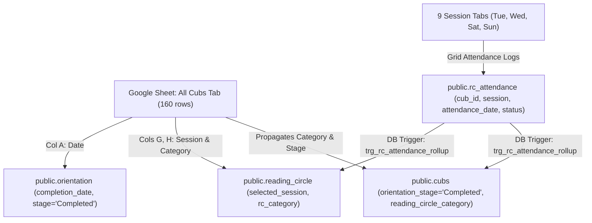

# Reading Circle & Orientation Data Migration Analysis

This report outlines the structural analysis of the [Reading Circle Google Spreadsheet](https://docs.google.com/spreadsheets/d/18trcU_16Nb_4lsi76d1xY90qNLMFDpbRUoRVchuNQlY/edit?resourcekey=&gid=1338261298#gid=1338261298) and defines the exact data mapping into the CERO Tracker database (`dpvgnzqioqihrihabeje`).

---

## 1. Executive Summary & Inventory

An automated audit of the spreadsheet using the Google Sheets MCP tool identified **16 tabs**:

| Category | Tab Name | Purpose / Structure | Record Count |
| :--- | :--- | :--- | :--- |
| **Directory Master** | `All Cubs` | Roster of all Reading Circle cubs with completion/join dates, categories, session assignments, and historical totals (`No. Present`, `No. Absent`). | **160 rows** (159 valid Cub IDs + 1 unassigned registration) |
| **Weekly Sessions** | 9 Session Tabs (`Tuesday - 5pm`, `Tuesday - 6pm`, `Wednesdays - 5pm`, `Wednesdays - 6pm`, `Saturday - 8am`, `Saturday - 9am`, `Saturday - 10am`, `Sunday- 3pm`, `Sunday- 4pm`) | Grid tracking weekly sessions from **19-Jun-2026** to **20-Oct-2026**. Each session week has a 3-column block: `CER Rep`, `Attendance` (`Present`/`Absent`), and `Feedback`. | **2,259 attendance logs** across **161 unique cubs** |
| **Historical & Form** | `Form Response` | Raw Google Form registration submissions. | 1,400+ form rows |
| **System & Setup** | `Config`, `Archive`, `Log`, `Reports`, `Sheet15` | Lookup configurations (Zoom links, session schedules), transaction logs, and archived rows. | Reference only |

---

## 2. Key Data Findings & Reconciliations

### 2.1 Database Presence Check
- **159 out of 159 (100%)** cub IDs in `All Cubs` exist in `public.master_cubs` and `public.cubs`.
- **158 out of 159** already have an auto-enrolled row in `public.orientation` in an initial `Invited` or `Booked` stage.
- **1 cub (`C25219090818473` - Asher Asihene Osei-Agyapong)** is under the `CDLS` segment instead of `Gen. Comm`, so he was not automatically enrolled by `enroll_gen_comm_orientation()`. An `orientation` record will be created for him during migration.
- **0 records** currently exist in `public.reading_circle` and `public.rc_attendance` in Supabase.

### 2.2 Sibling / Extra Cubs in Session Sheets
Two active cubs were present in the session sheets with attendance records but omitted from the summary `All Cubs` tab:
1. **`C26188180719961` (Phebe Sedinam Adzove)** in `Saturday - 9am` (sibling of Nathaniel Sedufia Adzove `C26188180719960` who is in `All Cubs`).
2. **`C26154190619895` (Mercedes Yeyi Koomson)** in `Sunday- 3pm` (sibling of Albert Nana Sompa Koomson `C26154190619894` who is in `All Cubs`).

Both exist in `master_cubs` and will be included in the migration.

### 2.3 Row 161 Placeholder
Row 161 in `All Cubs` lists `Jannel Owusu Sekyere` (Parent: Wendy Adjivon) with a blank Cub ID, 0 weeks active, and 0 attendance. She has no sessions in the weekly tabs and will be skipped.

### 2.4 Date Header Gaps in Weekly Tabs
In several session tabs (`Sunday- 3pm`, `Sunday- 4pm`, `Saturday - 9am`, `Saturday - 10am`, `Wednesdays - 5pm`), row 1 has blank or whitespace (`"\t\t\t"`) headers for specific columns (e.g. July 12, July 19, August 2). However, reps recorded full attendance for all cubs in those columns.
- By interpolating the regular 7-day calendar intervals between the preceding and succeeding dates, 100% of those 269 orphaned attendance entries can be recovered and timestamped accurately.

---

## 3. Database Schema Mapping

### A. Table: `public.orientation`
All Reading Circle cubs have completed orientation:
- `stage`: `'Completed'`
- `stage_status`: `'Completed'`
- `next_stage`: `NULL`
- `completion_date`: Parsed date from Column A of `All Cubs` (or Join Date from the session sheet).
- `invited_status`: `'Yes'`
- `booked_status`: `'Completed'`, `booked_date`: `completion_date`
- `attended_status`: `'Present'`, `attended_date`: `completion_date`
- `first_win_status`: `'Yes'`, `first_win_date`: `completion_date`
- `rc_selected_status`: `'Completed'`, `rc_selected_date`: `completion_date`

### B. Table: `public.reading_circle`
- `cub_id`: Cub Library Card Number
- `selected_session`: Canonical session name matching system config (e.g., `Sundays 4:00 pm – 4:45 pm`)
- `rc_category`: Assigned Reading Circle category (e.g., `Word Miners - Sunday`, `Word Astronauts - Sunday`)
- `weeks_active`: From Column I of `All Cubs`
- `no_present`: Atomic rollup count of `Present` records
- `last_attendance_date`: Max `attendance_date` where status was `Present`

### C. Table: `public.rc_attendance`
- `cub_id`: Cub Library Card Number
- `session`: Canonical session name
- `attendance_date`: Parsed session date (`YYYY-MM-DD`)
- `status`: `'Present'` or `'Absent'`
- `recorded_by`: UUID from `auth.users`. Mapped by rep name (`kezia@perbicubs.com`, `majorie@perbicubs.com`, or fallback to Admin `admin@cero.com` for reps without auth accounts such as Theodore and Priscilla).

### D. Table: `public.cubs` (Directory Synchronization)
- `orientation_stage`: `'Completed'`
- `orientation_stage_status`: `'Completed'`
- `orientation_next_stage`: `NULL`
- `orientation_completion_date`: `completion_date`
- `reading_circle_category`: `rc_category`
- `no_present`: Atomic rollup from `rc_attendance`
- `last_attendance_date`: Atomic rollup from `rc_attendance`

---

## 4. Execution Plan

1. **Pre-Migration Safety Backup**: Take snapshot of current `orientation` and `cubs` states.
2. **Execute Transactional Migration**:
   - Step 1: Batch upsert `public.orientation` (161 records) and update `public.cubs`.
   - Step 2: Batch upsert `public.reading_circle` (161 records).
   - Step 3: Batch upsert `public.rc_attendance` (2,259 records in chunks of 500) using `ON CONFLICT (cub_id, attendance_date) DO UPDATE`.
   - Step 4: Verify that the DB trigger `trg_rc_attendance_rollup` correctly recalculated `no_present` and `last_attendance_date`.
3. **Verification**: Compare final DB stats against the sheet totals.
